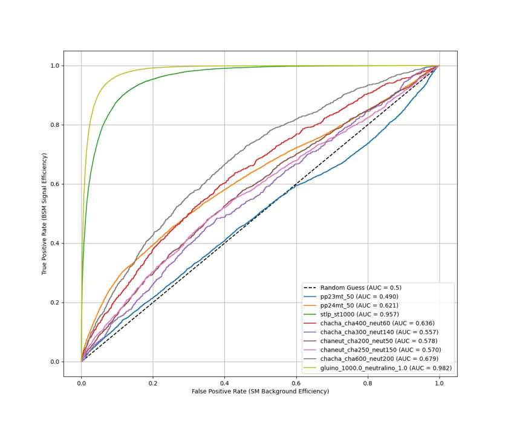
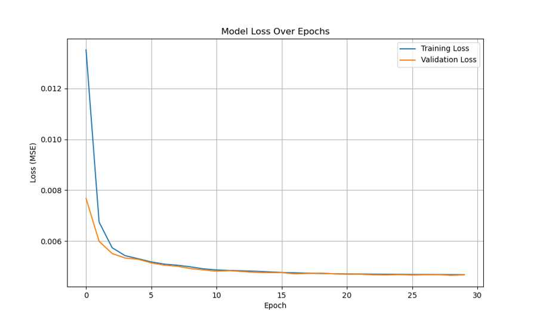
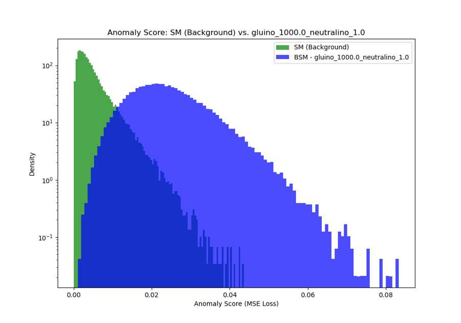
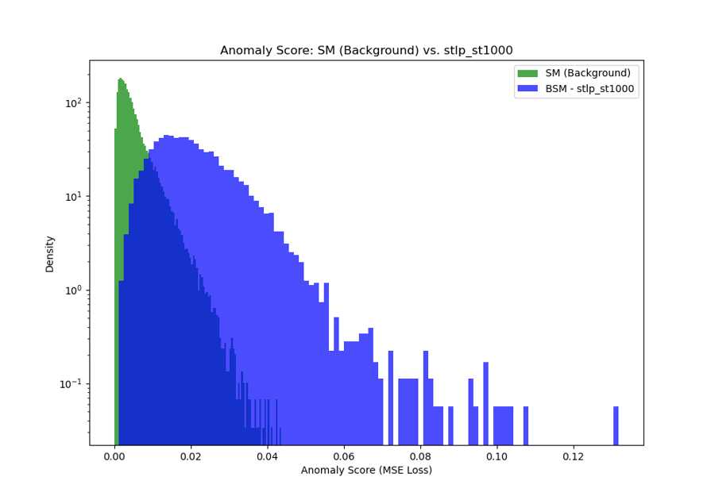
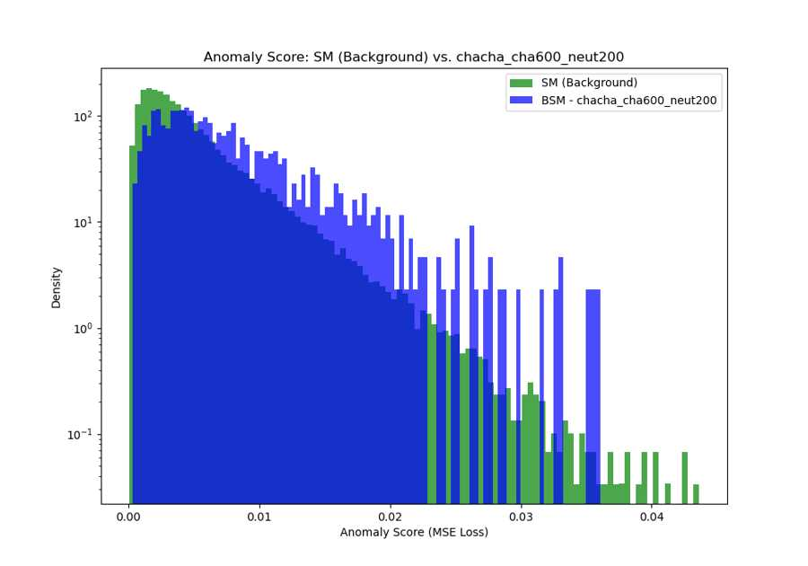

# Unsupervised Anomaly Detection in LHC Event Data

**Saqib Umair**  
MSc Particle and Nuclear Physics, University of Edinburgh

This project studies whether a compact autoencoder trained only on Standard Model (SM) collision events can identify Beyond Standard Model (BSM) benchmark samples through reconstruction error.

The analysis uses the channel-2b setup from the **Dark Machines Anomaly Score Challenge**. The aim is not to build a supervised classifier for one signal model, but to test a background-trained anomaly score across several different BSM topologies.

## Key result

The reconstruction-error score gives very different sensitivity across the benchmark samples:

| BSM benchmark | ROC AUC |
|---|---:|
| `gluino_1000.0_neutralino_1.0` | **0.982** |
| `stlp_st1000` | **0.957** |
| `chacha_cha600_neut200` | 0.679 |
| `chacha_cha400_neut60` | 0.636 |
| `pp24mt_50` | 0.621 |
| `chaneut_cha200_neut50` | 0.578 |
| `chaneut_cha250_neut150` | 0.570 |
| `chacha_cha300_neut140` | 0.557 |
| `pp23mt_50` | **0.490** |

The strongest separation is obtained for the gluino and `stlp_st1000` samples. Several other benchmarks overlap strongly with the SM background, while `pp23mt_50` is effectively indistinguishable with this score.

That spread is the main result of the study: **a background-trained autoencoder can provide strong anomaly sensitivity for some event topologies, but not uniformly across all BSM scenarios.**



## Event representation

Each collision event is converted into a fixed **39-feature** vector:

- 5 particle multiplicities: electrons, muons, jets, b-jets and photons;
- `log(MET)` and `METphi`;
- the 8 highest-energy reconstructed objects, each represented by `log(E)`, `log(pT)`, `eta` and `phi`.

The SM sample contains **340,268 events**. An 80/20 split gives:

- **272,214 training events**
- **68,054 test events**

The `MinMaxScaler` is fitted only on the SM training sample and then applied to the held-out SM sample and all BSM samples, avoiding leakage from the evaluation data.

## Autoencoder

The network is deliberately small:

```text
39 inputs -> 32 -> 8 latent features -> 32 -> 39 outputs
```

ReLU activations are used in the hidden layers and a sigmoid output is used because the engineered input features are scaled to `[0, 1]`.

Training uses:

- Adam optimiser
- learning rate `1e-3`
- mean-squared reconstruction loss
- 30 epochs
- validation-based checkpointing

The lowest validation loss in the saved run was approximately **0.004652**.



## Anomaly score

For each event, the anomaly score is the mean reconstruction error across all 39 input features:

```text
anomaly score = mean((reconstruction - input)^2)
```

The same score is calculated for the SM test set and all nine BSM samples.

### Examples

**Strong separation — gluino benchmark**



**Strong separation — stlp benchmark**



**Moderate separation — chacha benchmark**



All nine anomaly-score distributions are available in [`figures/anomaly_scores/`](figures/anomaly_scores/).

## What I implemented

- parsing of the variable-length event format;
- particle counting, energy sorting, truncation and zero-padding;
- logarithmic transformation of energy-scale variables;
- train/test splitting and training-only feature scaling;
- PyTorch autoencoder design and training;
- validation-based model checkpointing;
- per-event reconstruction-error scoring;
- ROC/AUC evaluation across nine BSM benchmark samples.

## Repository structure

```text
.
├── README.md
├── requirements.txt
├── notebooks/
│   └── lhc_bsm_autoencoder_anomaly_detection.ipynb
├── src/
│   ├── preprocessing.py
│   ├── model.py
│   ├── training.py
│   └── evaluation.py
├── models/
│   └── best_autoencoder.pt
├── figures/
│   ├── training_loss_plot.jpg
│   ├── roc_curves_combined.jpg
│   └── anomaly_scores/
├── results/
│   └── auc_summary.csv
└── data/
    └── README.md
```

## Data and reproducibility

The raw event CSV files and cached processed NumPy arrays are not redistributed here. They were supplied for the course project, so this repository does not assume redistribution rights for those datasets.

The preprocessing code, expected file structure, trained checkpoint, evaluation code and saved analysis figures are included. See [`data/README.md`](data/README.md) for the expected inputs.

The public notebook is a cleaned presentation of the analysis rather than the original submission file; course administration material has been removed while the technical workflow and reported results are preserved.

## Tools

Python · PyTorch · NumPy · pandas · scikit-learn · Matplotlib · tqdm

## Project context

Completed as a particle-physics data-analysis and machine-learning project during the MSc Particle and Nuclear Physics programme at the University of Edinburgh.
